```markdown
<div align="center">

# Hi there, I'm Kangana Gupta 👋

**Computer Science Student · Aspiring Data Analyst · B.Tech 2027**

[](https://linkedin.com/in/kangana-gupta)
[](https://github.com/kanganagupta)
[](https://leetcode.com/u/Kangana_gupta)
[](mailto:kanganagupta2005@gmail.com)

</div>

---

## 🙋‍♀️ About Me

I'm a third-year Computer Science student at **Bansal Institute of Research and Technology, Bhopal**, passionate about transforming raw data into meaningful insights and business decisions.

- 🎓 B.Tech Computer Science & Engineering (2023–2027)
- 📊 Interested in Data Analytics, MIS Reporting, and Business Intelligence
- 💻 Hands-on experience with Python, SQL, Excel, and Power BI
- 📈 Experienced in EDA, data cleaning, customer segmentation, and dashboard development
- 🤖 Exploring Machine Learning and predictive analytics
- 🏆 Participated in Smart India Hackathon 2026
- 💡 Solved **59+ LeetCode problems** across Python, C++, and MySQL

---

## 🛠️ Tech Stack

**Languages & Databases**


**Data Analysis & Machine Learning**


**Visualization & Reporting**


**Tools & Platforms**


---

## 🚀 Featured Projects

### 📊 Customer Behaviour Analysis — Segmentation & Insights Dashboard
> `Python` `Pandas` `Scikit-learn` `SQL` `Power BI` `Excel`

[🔗 View Repository](https://github.com/kanganagupta/customer_behaviour_analysis)

- Analysed a dataset containing **10,000+ records** through data cleaning, deduplication, SQL aggregation, and exploratory data analysis.
- Applied **K-Means and Hierarchical Clustering** to identify customer segments.
- Evaluated cluster performance using the Elbow Method and Silhouette Score.
- Developed an interactive **Power BI dashboard** to visualize spending trends, demographic impact, and segment-level business metrics.

---

### 💰 Expense Tracker — Automated Finance Analytics Pipeline
> `Python` `Pandas` `NumPy` `Tkinter` `SQL` `Excel`

[🔗 View Repository](https://github.com/kanganagupta/expense-tracker)

- Built a Python-based expense tracking pipeline processing **50+ daily transactions**.
- Implemented data cleaning, deduplication, and SQL-based structured storage.
- Developed an interactive Tkinter dashboard for expense monitoring.
- Tracked spending patterns across **5+ expense categories**.

---

### 📦 Zepto SQL Analysis — Inventory & Business Insights
> `SQL` `Excel`

[🔗 View Repository](https://github.com/kanganagupta/Zepto_SQL_data_analysis.sql)

- Analysed a Kaggle inventory dataset containing **10,000+ records**.
- Wrote **15+ SQL queries** using CTEs, Window Functions, CASE statements, and subqueries.
- Investigated revenue potential, discount patterns, out-of-stock products, and category-level inventory.
- Extracted business insights to understand inventory performance and product availability.

---

### 🎲 Algorithmic Board Game — State Management & AI Logic
> `Python` `Tkinter`

- Developed a **4-player, 100-tile board game** using state-machine architecture.
- Implemented event-driven design and probabilistic dice simulation.
- Created **10+ reusable functions** covering collision detection, UI rendering, and state transitions.

---

## 📜 Certifications & Job Simulations

| Certification / Experience | Issuer | Year |
|---|---|---|
| Data Analytics Job Simulation | Deloitte Australia (Forage) | 2024 |
| Data Analyst Internship – Certificate of Participation | MHTECHIN via Unstop | 2026 |
| GenAI Powered Data Analyst Job Simulation | Forage | — |
| Machine Learning Using Python | SkillUp | — |
| IoT and Digital Transformation | Cisco | — |

---

## 🏆 Achievements

- 🥇 Participated in **Smart India Hackathon 2026**, collaborating on a solution combining migrant health records and student mental health problem statements.
- 💻 Solved **59+ LeetCode problems** across Python, C++, and MySQL.
- 📊 Developed multiple end-to-end analytics projects using real-world datasets.

---

<p align="center">
  
</p>

## 📈 GitHub Stats

<div align="center">


</div>

---

## 🎯 Currently Working On

- 📚 Strengthening SQL, Python, and advanced data analysis skills.
- 📊 Building practical dashboards and business intelligence projects.
- 🤖 Exploring Machine Learning fundamentals and predictive analytics.
- 🧩 Improving problem-solving skills through consistent LeetCode practice.

---

<div align="center">

*Turning data into insights, one query at a time.* 🚀

**Open to Data Analyst opportunities, internships, and collaborations. Let's connect!**

</div>
```
